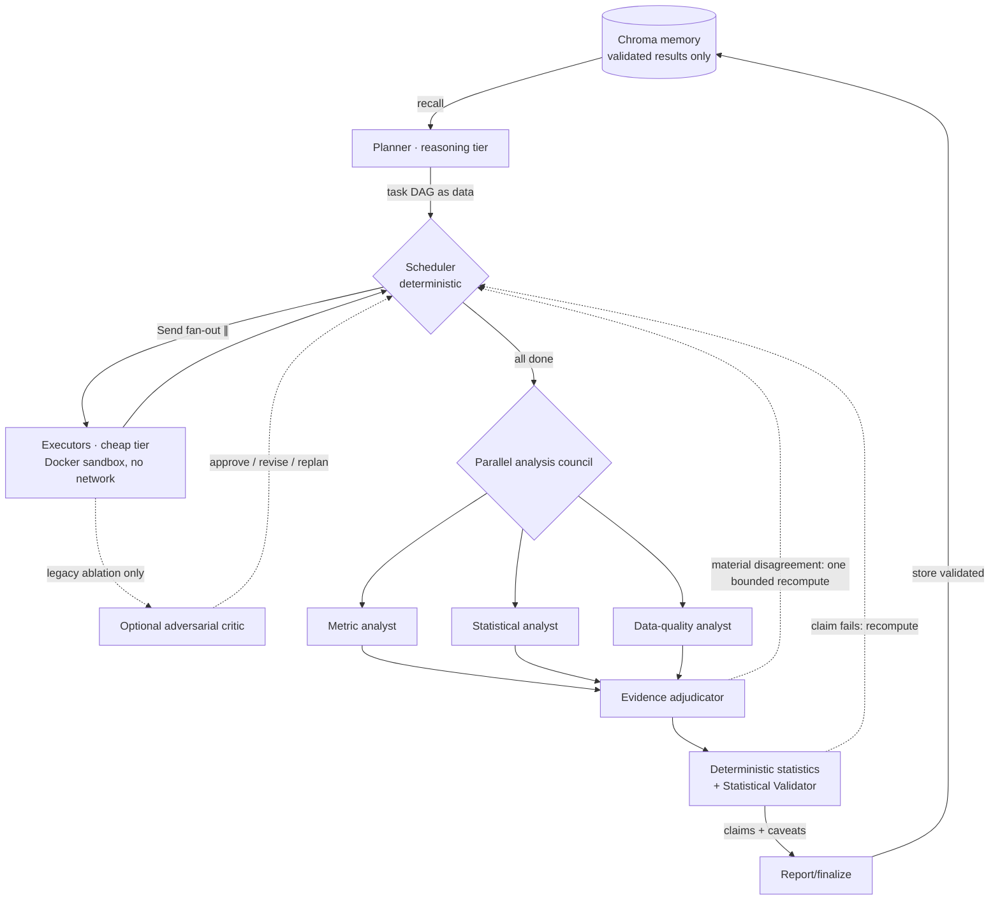

# analyst — a multi-agent autonomous data analyst

A natural-language business question + a dataset goes in; specialized LLM agents
plan the work, execute Python/SQL in isolated containers, optionally deliberate in a
parallel **analysis council**, and pass claims through a statistical validator before
validated results enter memory. Built to be defensible under systems-design
questioning, with an evaluation harness as the centerpiece rather than a demo.

**The useful version in one sentence:** upload related CSV tables in the browser and
ask a business question; it plans the analysis, runs generated Python/SQL in an
isolated container, automatically profiles distributions and data-quality risks,
can train leakage-aware predictive models, and returns an answer with statistically
reviewed caveats. The React UI streams the task graph and typed EDA/model evidence
so a user can see what ran, failed, or escalated instead of receiving an unexplained
chatbot answer.

**The thesis, and the receipt:** review agents are usually decorative. Here every
agent must earn its cost. On a 25-question benchmark with planted analytical traps,
the selected high-assurance policy scores **0.86**, versus **0.56** for a bare
planner/executor. Ablations also show what to delete: the statistical validator is
load-bearing, the parallel council improves maximum accuracy, and the adversarial
critic adds no overall accuracy while false-positive flagging 50% of sound controls.
The shipped defaults follow that evidence instead of retaining every agent.

```
python -m analyst eval --data data/sample --provider hosted \
    --configs council-no-critic,adaptive-council,full-council,full,no-critic,no-validator,bare \
    --critic-bench
# -> eval_results/SCORECARD.md
python -m analyst scorecard     # re-score saved raw outputs at $0
```

The scorecard command has an integrity gate: only complete 25-question runs with
zero execution errors are eligible, and it lists the raw source file behind every
row. A cassette miss or interrupted run remains available for debugging but cannot
silently replace valid headline metrics.

## Architecture in one diagram



Key decisions (full reasoning in [docs/ARCHITECTURE.md](docs/ARCHITECTURE.md), the
chronological story with every live failure in [docs/build-log.md](docs/build-log.md)):

- **Two-level graph.** LangGraph graphs compile statically, but the planner invents
  a new DAG per question — so the analysis DAG lives *in state* as data, and a
  deterministic scheduler fans ready tasks out to parallel executors via `Send`.
  Parallel writers merge through per-field reducers on disjoint keys: no locks.
- **Every loop is budgeted, and exhausted budgets degrade to honesty.** Crash
  retries, optional critic revisions, replans, validation passes — separate budgets; an
  unresolved objection ships as a caveat, never silently dropped.
- **Independent analysis, not a longer role chain.** Once task artifacts settle,
  metric, statistical, and data-quality specialists receive the same immutable
  evidence in three real parallel `Send` branches. A deterministic answer key avoids
  an adjudicator call when all three agree; disagreement invokes an evidence
  adjudicator that may send one existing task back for a single targeted recompute.
  The UI preserves each conclusion, confidence, evidence references, risks, and
  dissent instead of hiding the debate in a final summary.
- **Sandbox as a security component.** One throwaway Docker container per
  execution: no network, read-only rootfs, CPU/mem/pid caps, non-root, wall-clock
  kill. Generated SQL runs via DuckDB *inside* the sandbox — LLM code and the
  application database are never on the same side of the wall. Firecracker/microVMs
  are documented as the multi-tenant upgrade path, deliberately not built.
- **Automatic EDA before agent reasoning.** Dataset manifests include a deterministic
  full-table profile: missingness, duplicates, candidate/invalid keys, orphaned
  relationships, label inconsistencies, mixed types, categorical frequencies,
  numeric distributions/outliers, and date ranges. Typed findings and a transparent
  readiness score stream through the API and persisted run history into an
  expandable React report; the most important issues are also included in the
  schema context agents receive. The profiler recommends remediation but never
  silently deletes, imputes, or "fixes" records. Rules and boundaries are documented
  in [docs/DATA_QUALITY.md](docs/DATA_QUALITY.md).
- **Statistical arithmetic is code, not vibes.** For inferential questions, executors
  emit compact sufficient statistics and a deterministic SciPy layer computes
  Wilson/Newcombe and t intervals, exact/binomial/proportion/Welch/chi-square tests,
  and effect sizes including risk difference, odds ratio, Cohen's h/d, Hedges' g,
  and Cramer's V. Group-composition comparisons can also use pooled/equal/custom
  direct standardization, ranking-reversal diagnostics, and Mantel-Haenszel inference
  to turn confounding warnings into adjusted conclusions. The LLM validator interprets the evidence and checks design,
  assumptions, denominators, and confounding; it does not invent p-values. Invalid
  requests remain visible rather than crashing or disappearing. Full contracts and
  method boundaries are in [docs/STATISTICS.md](docs/STATISTICS.md).
- **Predictive performance means out-of-sample performance.** For classification or
  regression questions, agents emit a governed model specification rather than
  grading arbitrary generated code. A deterministic scikit-learn layer enforces
  random, temporal, or entity-group holdouts; selects logistic/ridge or random-
  forest candidates using training-only cross-validation; compares a naive
  baseline; and reports holdout metrics, bootstrap uncertainty, permutation
  importance, and subgroup slices. Target-as-feature, identifier memorization,
  one-to-many joins, and entity/time leakage configurations fail visibly. Evidence
  flows through the validator, persistence, API, final answer, and React model panel.
  See [docs/PREDICTIVE_MODELING.md](docs/PREDICTIVE_MODELING.md).
- **Model routing is config, not code** (`config/routing.yaml`): reasoning tier
  (planner/council/validator) vs mechanical tier (executor), per provider. The eval
  treats the routing table as an experimental variable. Live finding already
  recorded: an 8B executor hallucinated columns and tables; the floor for reliable
  multi-table codegen sat higher than expected.
- **$0 regression and re-scoring strategy.** One `LLMClient` interface, four backends: any
  OpenAI-compatible hosted free tier (the scorecard below ran on **Cerebras**;
  Groq and Google AI Studio slot in via one env var), local Ollama, Anthropic
  (wired, dormant), and **replay** — prompt-exact recorded cassettes plus ordered
  scripted responses for stable tests. CI runs the entire suite (unit, replay e2e,
  API + WebSocket) deterministically with no keys, no Docker, and no model
  downloads. Saved raw benchmark outputs can always be re-scored at $0; prompt-exact
  live cassettes intentionally invalidate when a prompt template changes.
- **A held-out benchmark that cannot rewrite the original receipt.** A separate
  20-question product-analytics suite evaluates estimation, tests/effect sizes,
  stratified confounding, and design/data-quality reasoning on independently
  generated seeds. Component rubrics come from the evaluated CSV bytes, typed
  evidence fields are scored semantically, and a second integrity gate requires
  the exact item set, dataset hash, and zero errors. Multi-seed reports add a 95%
  interval only when at least two seeds exist. It has its own raw-result namespace
  and scorecard, so it cannot contaminate the development benchmark. See
  [docs/HELDOUT_BENCHMARK.md](docs/HELDOUT_BENCHMARK.md).
- **Memory that can't lie.** Only validator-passed results are stored; queries
  filter on the dataset's content hash (stale data = no hit, by construction);
  reuse skips LLM+sandbox+review with provenance citing the source run; a
  hallucinated memory id downgrades to recompute.

## The benchmark

25 questions over synthetic manufacturing data (machines, work orders, defects,
downtime, supplier lots) generated by our own script — so gold values are computed
from the same bytes the agents see, and the traps are *planted*, not hoped for:
a shift/job-mix confounder, survivorship via decommissioned machines, a
one-to-many join that double-counts, and a Simpson's-paradox supplier comparison.

Trap scoring rewards honesty: correct conclusion = 1.0, naive answer with the
trap named in a caveat = 0.5, confidently wrong = 0. A separate **critic-bench**
isolates the critic entirely: 10 handcrafted specimens (6 flawed, 4 sound
controls) measure flaw detection as precision/recall.

### Held-out statistical suite

The original benchmark remains the ablation receipt. A second, independently
generated product-analytics benchmark adds 20 questions—five each for estimation,
tests/effect sizes, confounding, and design/data-quality reasoning. It includes two
new composition reversals, a no-reversal sound control, conditional estimands,
fanout, nonresponse, multiplicity, missingness, and practical-significance checks.
Each question is scored by an auditable component rubric rather than an LLM judge.
Multiple dataset seeds are aggregated separately in
`heldout_eval_results/SCORECARD.md`.

No held-out model score is claimed yet. The implementation and oracle/integrity
tests are complete, but a fresh live run must pass its 20-question zero-error gate
before the resume or README gains another accuracy number.

## Scorecard: does the complexity pay off?

All live rows use the same model routing. Configs independently toggle the critic,
validator, and council; saved raw outputs pass an integrity gate requiring all 25
questions and zero execution errors.

Run on Cerebras (`gpt-oss-120b` reasoning tier, `gemma-4-31b` mechanical tier),
model held constant across ablation configs so the only variable is which
review agents are enabled. Overall score is mean over all 25 questions; tier-4 is
the honesty-weighted trap score above.

| config | overall | tier1 | tier2 | tier3 | tier4 traps | trap flag rate | mean latency | mean tokens |
|---|---|---|---|---|---|---|---|---|
| **council-no-critic** | **0.86** | 1.0 | 1.0 | 1.0 | 0.30 | 0.60 | 212.3s | 17,223 |
| full-council | 0.84 | 1.0 | 1.0 | 0.857 | **0.40** | **0.80** | 116.8s | 19,727 |
| adaptive-council | 0.80 | 1.0 | 1.0 | 0.857 | 0.20 | 0.40 | 110.6s | 19,892 |
| **full** (critic + validator) | 0.80 | 1.0 | 1.0 | 0.857 | 0.20 | 0.40 | 58.7s | 8,086 |
| no-validator (critic only) | 0.68 | 1.0 | 1.0 | 0.571 | 0.00 | 0.00 | 34.1s | 6,775 |
| **no-critic (standard)** | 0.80 | 1.0 | 0.857 | 1.0 | 0.20 | 0.40 | **27.6s** | **3,429** |
| **bare** (planner + executor) | 0.56 | 1.0 | 0.714 | 0.429 | 0.00 | 0.00 | 0.4s* | 2,007 |

**The complexity is justified — but not uniformly, and the table says where.**

*The high-assurance policy beats the naive baseline by 30 points* (0.86 vs 0.56)
and is perfect on tiers 1–3. The council is not free: compared with the standard
validator-only path, it gains 6 points while using about **5× the tokens**. The UI
therefore exposes it as an explicit high-assurance mode, not the universal default.

*The statistical validator remains load-bearing.* Removing it
(full → no-validator) costs 12 points overall, drops tier-3 from 0.857 to 0.571,
and drops trap-flagging to zero — without the validator, the system stops naming its
own confounders. That is the single clearest "this earns its complexity" result in
the table.

*The critic failed its deletion test.* `full` and `no-critic` both score 0.80, while
the critic uses 2.36× the tokens. More decisively, removing it from the council path
raises overall score from 0.84 to 0.86 and reduces mean tokens by about 13%.
Consequently it is disabled in both shipped modes and remains only as an opt-in
ablation (`--critic`).

*Adaptive routing also failed to earn its place.* `adaptive-council` scores the same
0.80 as the standard path but uses 19,892 rather than 3,429 mean tokens. It remains
available as an experimental policy, but it is no longer recommended or default.

*Critic-bench explains why.* Isolated on handcrafted specimens, the critic catches
**83% of real flaws** (recall) but **false-positives on 50% of sound analyses** —
it cries wolf as often as it's right. That noisiness is exactly what dilutes its
end-to-end contribution: a reviewer that flags good work half the time can't move
the aggregate score much, even when it's catching genuine bugs.

| specimen class | verdict | correct? |
|---|---|---|
| join fan-out, survivorship, silent nulls, averaging averages, goal mismatch | revise | ✓ (5/6 flaws caught) |
| confounded comparison | approve | ✗ missed |
| 2 sound controls | approve | ✓ |
| 2 sound controls | revise | ✗ false alarm |

**The published weak spot: traps.** The council raises trap score to 0.40 and
flagging to 0.80, but the saved live run often produced a caveat rather than the
fully adjusted answer. Since that run, deterministic stratified recomputation has
been added and now corrects the planted composition reversals in tests. The saved
scorecard remains unchanged until a fresh live evaluation measures the improvement;
survivorship bias remains *flagged-not-fixed*.

_*The bare latency row came from deterministic replay, while the matched council
latency comparison came from the two July 10 live runs. Do not compare bare latency
to live-model rows._

_Caveat on rigor: tier-4 is 5 trap questions at temperature 0.2, so those specific
numbers carry real variance — treat the trap column as directional, and see the
multi-seed note in future work. The committed raw outputs reproduce the scorecard at
$0; prompt-exact cassettes replay only while their prompts remain unchanged._

## Running it

```bash
# dev: everything in one process, UI live at :5173
pip install -e ".[dev]"
python -m analyst gen-data --out data/sample
ANALYST_DEV_INPROCESS=1 ANALYST_LLM_PROVIDER=hosted ANALYST_SANDBOX=docker \
    uvicorn analyst.api.app:app --port 8000
cd frontend && npm install && npm run dev
# In the UI, choose up to 12 related CSVs (20 MB total) or use data/sample.
# "Standard" is the product default; "High assurance" invokes the council.
# "Adaptive" remains visible as an experimental negative result.

# CLI
python -m analyst ask "Which shift has the best quality record?" \
    --data data/sample --provider hosted --sandbox docker
# standard: validator only (default)
# high assurance: add --council-mode always
# legacy critic ablation: add --critic

# full stack: Postgres ledger, Redis queue + pub/sub, arq worker, Jaeger tracing
# hosted = any OpenAI-compatible endpoint; the scorecard ran on Cerebras (free, no card)
export ANALYST_HOSTED_BASE_URL=https://api.cerebras.ai/v1
export ANALYST_HOSTED_API_KEY=csk_...
export ANALYST_ROUTING_CONFIG=config/routing.cerebras.yaml
docker compose up --build     # UI :8080 · API :8000 · traces :16686

# tests ($0, no keys, no Docker): what CI runs on every push
python -m pytest tests/ -q

# rebuild the published ablation table from verified saved runs
python -m analyst scorecard

# separate held-out statistical evaluation (20 questions per generated seed)
python -m analyst heldout-eval --provider hosted --configs no-critic \
  --seeds 20260717,20260718 --resume
python -m analyst heldout-scorecard  # rebuild valid held-out runs at $0
```

Requires: Python 3.10+, Docker (Colima works; 2GB VM is enough), Node 22 for the
frontend, and a free API key from any OpenAI-compatible host (Cerebras — used for
the scorecard — Groq, or Google AI Studio; no card) — or Ollama for fully-offline
local mode.

## Honest limitations

- Confidence intervals, effect sizes, and core hypothesis tests are deterministic,
  and categorical confounding can be recomputed with direct standardization and
  Mantel-Haenszel methods. Multiple-comparison correction, power/equivalence
  analysis, continuous or high-cardinality regression adjustment, and causal
  identification are not yet implemented.
- The published tier-4 result (0.30 correct / 0.60 flagged) predates deterministic
  stratified recomputation. The implementation now corrects the planted job-mix and
  supplier-mix reversals in tests, but a fresh live benchmark is required before the
  headline score can change. Survivorship adjustment remains flagged-not-fixed.
- The critic is trigger-happy: 0.50 false-positive rate on sound analyses in
  critic-bench and no end-to-end benefit. It is retained only for reproducibility.
- Council trap results are one N=5 run per config. Treat trap deltas as directional
  until the selected policy is repeated across seeds.
- The held-out statistical suite has no published live score yet. Its generator,
  runtime ground truth, component rubrics, multi-seed aggregation, and integrity
  gate are tested; implementation completeness is not model-performance evidence.
- Predictive modeling currently evaluates binary classification and regression up
  to 100,000 rows/50 features. It does not yet persist deployable model artifacts,
  serve predictions, handle forecasting/multiclass/survival objectives, or replace
  domain review of feature timing, fairness, calibration, and drift.
- Prompt-exact cassettes are a regression tool, not a permanent cache: editing an
  agent prompt creates an intentional miss and requires re-recording. The committed
  raw benchmark outputs remain independently scoreable and provenance-linked.
- Adaptive risk routing is implemented and tested, but its live run failed to save
  cost or accuracy; it remains experimental rather than a shipped default.
- Parallel executor spans may not nest under their scheduler cycle in Jaeger
  (thread-context propagation; noted in `analyst/tracing.py`).
- EDA currently performs an exact full-file scan. The browser path is capped at
  20 MB; warehouse-scale datasets would need chunked or database-native profiling
  plus explicit domain constraints and sensitive-column redaction.
- Single-user system: no auth, no multi-tenancy; the docker-socket mount in
  compose is root-equivalent on the host daemon and is called out in the file.

## Repo map

```
analyst/agents/     planner, executor, critic, council/adjudicator, validator
analyst/graph/      state models, reducers, scheduler, LangGraph control loop
analyst/sandbox/    runner contract, Docker backend, dev backend
analyst/llm/        client protocol: hosted/local/anthropic/replay + cassettes
analyst/memory/     Chroma store: validated-only writes, content-hash staleness
analyst/quality.py  deterministic EDA, quality rules, relationship checks, score
analyst/modeling/   governed sklearn pipelines, splits, metrics, diagnostics
analyst/api/        FastAPI, WebSocket streaming, arq worker, run stores (JSON/PG)
analyst/eval/       data generator w/ planted traps, benchmark, critic-bench,
                    held-out statistical suite, harnesses, scorecards
frontend/           React + TS live DAG (Vite, React Flow)
docker/             sandbox image, app/frontend images, nginx; compose at root
docs/               ARCHITECTURE.md (design), build-log.md (chronology + failures)
                    STATISTICS.md (deterministic inference contract + assumptions)
                    DATA_QUALITY.md (automatic EDA rules, scoring, boundaries)
                    HELDOUT_BENCHMARK.md (20-question out-of-sample evaluation)
                    PREDICTIVE_MODELING.md (modeling contract + leakage boundaries)
```
