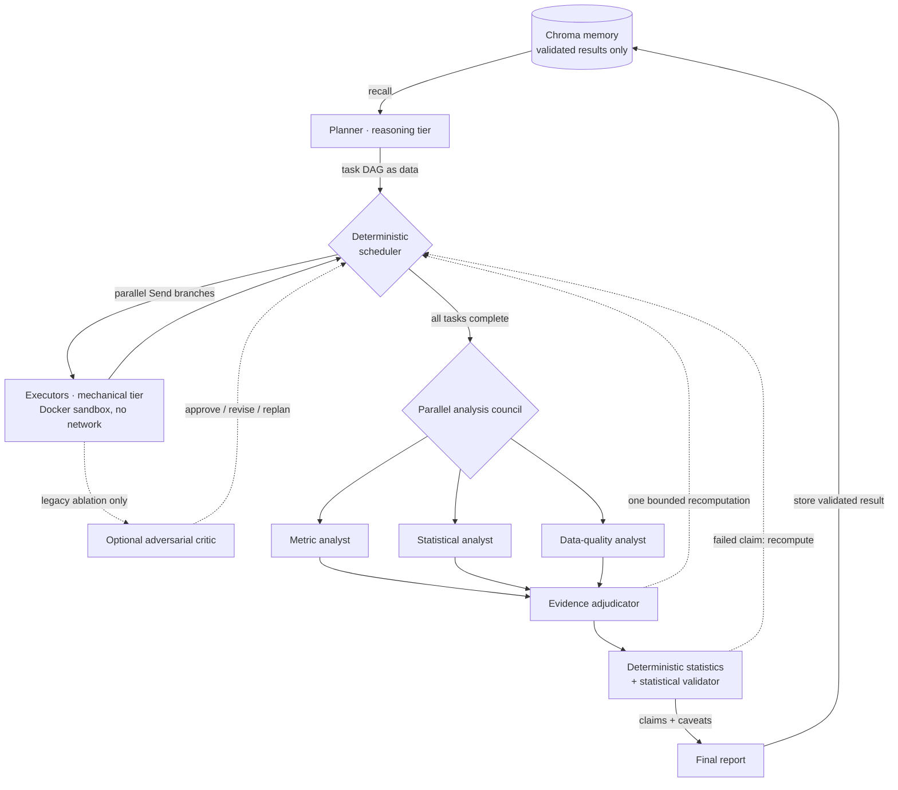

# Analyst: A Multi-Agent Data Analyst

Analyst takes a business question and a set of related CSV files, plans the work,
runs Python or SQL in isolated containers, and returns an answer with statistical
checks and visible caveats.

I built this project because a convincing data agent needs more than a good demo.
It should handle messy relational data, show how it reached an answer, and prove
that its extra agents actually improve the result. The repository therefore
includes the application, a reproducible evaluation harness, ablation results,
and the raw runs behind the published metrics.

The browser interface streams the task graph while it runs. It also shows data
quality findings, statistical evidence, model evaluation results, reviewer
decisions, and unresolved objections. Completed runs export self-contained HTML
reports and JSON evidence with dataset provenance and visible caveats.
Completed runs also support contextual follow-up questions: each creates a new
analysis with source-run lineage, inherited review settings, and dataset-hash
checks before queuing and execution. See [follow-up analyses](docs/FOLLOWUPS.md).

**Try a key-free example:** download [the sample analysis report](examples/analysis-report.html)
and open it in a browser, or run:

```bash
pip install -e "."
python -m analyst export-report examples/report_run.json --out report.html
```

The sample uses published synthetic modeling evidence and an illustrative
narrative; it does not run or impersonate the agent pipeline. See
[report export and provenance](docs/REPORTS.md).

## Results at a glance

- **0.86** on the 25-question benchmark for the selected high-assurance policy
- **0.56** for the bare planner and executor baseline
- **0.80** for the faster Standard mode
- **71.9%** on a separate held-out statistical benchmark across 40 question
  instances and two independently generated seeds
- **0 execution errors** in every scorecard run used for these headline results

The main finding was not that more agents are always better. The statistical
validator improved accuracy, while the adversarial critic added cost without
improving the overall score. I removed the critic from the default product path
and kept it only as a reproducible ablation.

## Architecture



### What happens after a question

1. The planner turns the question into a task DAG.
2. A deterministic scheduler finds tasks whose dependencies are ready.
3. Independent tasks run in parallel through LangGraph `Send` branches.
4. Generated Python and SQL execute inside short-lived Docker containers.
5. Deterministic layers compute data-quality, statistical, and predictive evidence.
6. Standard mode sends the result to a statistical validator.
7. High-assurance mode also sends the same evidence to three independent council
   specialists.
8. Validated results can enter memory and are returned with their provenance and
   caveats.

## Design choices

### A static graph with a dynamic analysis plan

LangGraph compiles a static control graph, but each question needs a different
analysis plan. I store the planner's task DAG in graph state and let a deterministic
scheduler walk it. Parallel tasks write to separate state keys, so their results can
merge without locks.

### Sandboxed execution

Every generated program runs in a disposable Docker container with:

- no network access
- a read-only root filesystem
- non-root execution
- CPU, memory, process, and time limits
- read-only access to the supplied dataset

DuckDB also runs inside the sandbox. Generated SQL never shares a process with the
application database. This setup is intended for a single-user local application.
A multi-tenant deployment would need stronger isolation such as gVisor, Firecracker,
or a dedicated sandbox service.

### Automatic data profiling

Before the agents reason about a dataset, a deterministic profiler checks:

- missing values and duplicate rows
- candidate and invalid keys
- orphaned relationships
- inconsistent labels and mixed types
- categorical frequencies
- numeric distributions and outliers
- date ranges

The report includes a transparent readiness score and recommended fixes. It does
not silently delete, impute, or modify records. The full rules are documented in
[docs/DATA_QUALITY.md](docs/DATA_QUALITY.md).

### Deterministic statistical evidence

Executors provide sufficient statistics, then SciPy code computes the actual
inference. The LLM validator interprets those results but does not invent p-values.

Supported methods include:

- Wilson, Newcombe, and t confidence intervals
- exact binomial, proportion, Welch, and chi-square tests
- risk difference, odds ratio, Cohen's h, Cohen's d, Hedges' g, and Cramer's V
- pooled, equal, and custom direct standardization
- ranking-reversal diagnostics
- Mantel-Haenszel inference

Invalid requests remain visible in the result instead of disappearing or crashing
the run. See [docs/STATISTICS.md](docs/STATISTICS.md) for the request contract and
method assumptions.

### Governed predictive modeling

For prediction questions, the agents produce a model specification. A deterministic
scikit-learn layer owns training and evaluation.

It supports:

- binary classification and regression
- logistic regression, ridge regression, and random forests
- random, temporal, and entity-group holdouts
- training-only cross-validation for model selection
- comparison with a naive baseline
- bootstrap intervals for holdout metrics
- permutation feature importance
- subgroup performance slices

The engine rejects target-as-feature leakage, identifier memorization,
row-multiplying joins, and invalid time or entity splits. Predictive evidence is
available in the validator, API, CLI, saved runs, final answer, and React interface.
See [docs/PREDICTIVE_MODELING.md](docs/PREDICTIVE_MODELING.md).

### Two product modes

**Standard** uses the planner, sandboxed executors, deterministic evidence, and the
statistical validator. This is the default because it provides the best
cost-to-accuracy tradeoff.

**High assurance** adds three parallel reviewers:

- metric analyst
- statistical analyst
- data-quality analyst

If all three support the same answer key, the graph skips an additional adjudicator
call. If they disagree, an adjudicator can request one targeted recomputation of an
existing task. The interface keeps dissent and risks visible.

### Validated memory

Only validator-passed results are stored. Retrieval is filtered by the dataset
content hash, so a result from stale data cannot be reused for a changed dataset.
Every reused answer points back to its source run and task.

## Evaluation

### Development benchmark

The main benchmark contains 25 questions over generated manufacturing data:
machines, work orders, products, defects, downtime, suppliers, and material lots.
Gold answers are computed from the same generated CSV files used in each run.

The harder questions include planted failure modes:

- a shift and job-mix confounder
- survivorship bias from decommissioned machines
- a one-to-many join that double-counts rows
- a Simpson's paradox supplier comparison

Trap scoring gives full credit for the correct conclusion, half credit for a naive
answer that clearly flags the trap, and no credit for a confident incorrect answer.
Only complete 25-question runs with zero execution errors enter the scorecard.

### Ablation results

All configurations used the same model routing. The agents included in the control
loop were the experimental variable.

| configuration | overall | tier 1 | tier 2 | tier 3 | traps | trap flag rate | mean latency | mean tokens |
|---|---:|---:|---:|---:|---:|---:|---:|---:|
| **council-no-critic** | **0.86** | 1.0 | 1.0 | 1.0 | 0.30 | 0.60 | 212.3s | 17,223 |
| full-council | 0.84 | 1.0 | 1.0 | 0.857 | **0.40** | **0.80** | 116.8s | 19,727 |
| adaptive-council | 0.80 | 1.0 | 1.0 | 0.857 | 0.20 | 0.40 | 110.6s | 19,892 |
| full | 0.80 | 1.0 | 1.0 | 0.857 | 0.20 | 0.40 | 58.7s | 8,086 |
| no-validator | 0.68 | 1.0 | 1.0 | 0.571 | 0.00 | 0.00 | 34.1s | 6,775 |
| **no-critic (Standard)** | **0.80** | 1.0 | 0.857 | 1.0 | 0.20 | 0.40 | **27.6s** | **3,429** |
| bare | 0.56 | 1.0 | 0.714 | 0.429 | 0.00 | 0.00 | 0.4s* | 2,007 |

The results led to three product decisions:

1. Keep the validator. Removing it reduced the score from 0.80 to 0.68 and
   eliminated trap flagging.
2. Offer the council as a high-assurance option. It raised the best overall score
   from 0.80 to 0.86, but used roughly five times the tokens of Standard mode.
3. Disable the critic by default. It did not improve overall accuracy and flagged
   50% of sound controls in the isolated critic benchmark.

The bare latency came from deterministic replay, so it should not be compared
directly with the live-model latency rows. The trap tier contains five questions per
configuration, which makes those specific differences directional rather than
precise estimates.

The complete table and its raw-file provenance are in
[eval_results/SCORECARD.md](eval_results/SCORECARD.md).

### Held-out statistical benchmark

I added a separate 20-question product-analytics benchmark after building the main
system. It uses independently generated seeds, runtime-derived answers, an exact
item-set and dataset-hash gate, and component-level scoring.

The suite covers:

- interval estimation
- hypothesis tests and effect sizes
- stratified confounding
- study design and data quality

Two complete seeds produced the following result:

| metric | result |
|---|---:|
| overall rubric score | **71.9%** |
| estimation | 80.0% |
| tests and effect sizes | 65.5% |
| confounding | 72.5% |
| design and data quality | 69.5% |
| evaluated question instances | 40 |
| execution errors | 0 |

With only two seeds, the uncertainty interval is wide, so I treat this as an early
out-of-sample result rather than a final performance estimate. The full report is
in [heldout_eval_results/SCORECARD.md](heldout_eval_results/SCORECARD.md).

### Predictive reliability benchmark

The deterministic modeling engine passes **30/30 case instances** in a versioned,
API-free suite: ten scenarios across three fixed generated-data seeds. It covers
classification/regression signals, timestamp-safe and entity-disjoint holdouts,
no-signal and temporal-shift controls, and target/identifier/join leakage rejections.
The suite exposed and helped fix timestamp overlap in temporal holdout/CV splits
and acceptance of non-finite CV scores.

This is synthetic development coverage of fixed model specifications, separate
from agent accuracy and external predictive performance. The
[report and metrics](predictive_eval_results/REPORT.md),
[raw evidence](predictive_eval_results/results.json), and
[benchmark contract](docs/PREDICTIVE_BENCHMARK.md) document its scope and provenance.

```bash
python -m analyst predictive-benchmark
```

### Reproduce the scorecards

```bash
# Rebuild the original ablation scorecard from saved raw runs
python -m analyst scorecard

# Rebuild the held-out scorecard from saved raw runs
python -m analyst heldout-scorecard

# Run a new live held-out evaluation
python -m analyst heldout-eval --provider hosted --configs no-critic \
  --seeds 20260717,20260718 --resume
```

## Running the application

### Requirements

- Python 3.10 or newer
- Docker
- Node.js 22
- an API key for an OpenAI-compatible provider, or Ollama for local use

### Local development

```bash
pip install -e ".[dev]"
python -m analyst gen-data --out data/sample
docker build -t analyst-sandbox:latest -f docker/sandbox.Dockerfile .
```

Set the provider configuration. The published evaluation used Cerebras:

```bash
export ANALYST_HOSTED_BASE_URL=https://api.cerebras.ai/v1
export ANALYST_HOSTED_API_KEY=your_key_here
export ANALYST_ROUTING_CONFIG=config/routing.cerebras.yaml
```

Start the API:

```bash
ANALYST_DEV_INPROCESS=1 \
ANALYST_LLM_PROVIDER=hosted \
ANALYST_SANDBOX=docker \
uvicorn analyst.api.app:app --port 8000
```

Start the frontend in a second terminal:

```bash
cd frontend
npm install
npm run dev
```

Open [http://localhost:5173](http://localhost:5173).

### CLI

```bash
python -m analyst ask "Which shift has the best quality record?" \
  --data data/sample \
  --provider hosted \
  --sandbox docker
```

Add `--council-mode always` to use High-assurance mode.

After a run finishes, use **Download report** beside its answer, or export a CLI
snapshot without making more model calls:

```bash
python -m analyst export-report .analyst_runs/last_run.json --out report.html
```

In the browser, **Ask a follow-up** continues from the selected completed analysis
without re-uploading its data. If the dataset changed, the app asks you to start a
new analysis so the old context cannot silently refer to different CSVs.

### Full local stack

The complete stack includes Postgres, Redis, an arq worker, the React frontend, and
Jaeger tracing:

```bash
docker compose up --build
```

- application: [http://localhost:8080](http://localhost:8080)
- API: [http://localhost:8000](http://localhost:8000)
- traces: [http://localhost:16686](http://localhost:16686)

## Tests

The test suite uses replayed or scripted LLM responses, so it does not require API
keys, Docker, or model downloads.

```bash
python -m pytest tests/ -q

cd frontend
npm run build
```

GitHub Actions runs both checks plus the predictive reliability benchmark on every
push and uploads the benchmark's JSON evidence and Markdown report.

## Current limitations

- Statistical inference does not yet include multiple-comparison correction,
  power or equivalence analysis, continuous confounder regression adjustment, or
  causal identification.
- Survivorship bias is flagged but not automatically reconstructed into historical
  cohorts.
- Predictive modeling is limited to binary classification and regression with at
  most 100,000 rows and 50 features.
- The system does not persist deployable model artifacts or support forecasting,
  multiclass classification, survival analysis, calibration monitoring, or drift
  monitoring.
- The browser upload path is limited to 12 CSV files and 20 MB.
- Data profiling scans complete files in memory.
- The application is designed for one trusted local user. It has no authentication
  or multi-tenant isolation.
- The Docker socket used by the full local stack is root-equivalent on the host.
- Parallel executor traces may not always nest under the scheduler span in Jaeger.

## Repository layout

```text
analyst/agents/     planner, executor, critic, council, adjudicator, validator
analyst/graph/      state models, reducers, scheduler, LangGraph control loop
analyst/sandbox/    Docker and subprocess execution backends
analyst/llm/        hosted, local, Anthropic, and replay clients
analyst/memory/     validated-result Chroma store
analyst/modeling/   governed scikit-learn evaluation pipelines
analyst/api/        FastAPI, WebSockets, arq worker, JSON and Postgres stores
analyst/eval/       generators, benchmarks, harnesses, and scorecards
analyst/quality.py  deterministic profiling and data-quality rules
analyst/reporting.py portable HTML/JSON evidence reports
frontend/           React, TypeScript, Vite, and React Flow interface
docker/             sandbox, API, frontend, and Compose configuration
docs/               architecture, methods, limitations, and build history
```

More detail is available in:

- [Architecture](docs/ARCHITECTURE.md)
- [Build log](docs/build-log.md)
- [Statistical methods](docs/STATISTICS.md)
- [Data-quality rules](docs/DATA_QUALITY.md)
- [Held-out benchmark](docs/HELDOUT_BENCHMARK.md)
- [Predictive modeling](docs/PREDICTIVE_MODELING.md)
- [Predictive reliability benchmark](docs/PREDICTIVE_BENCHMARK.md)
- [Resume-ready project bullets](docs/RESUME_WRITEUP.md)
- [Report export and provenance](docs/REPORTS.md)
- [Follow-up analyses](docs/FOLLOWUPS.md)
