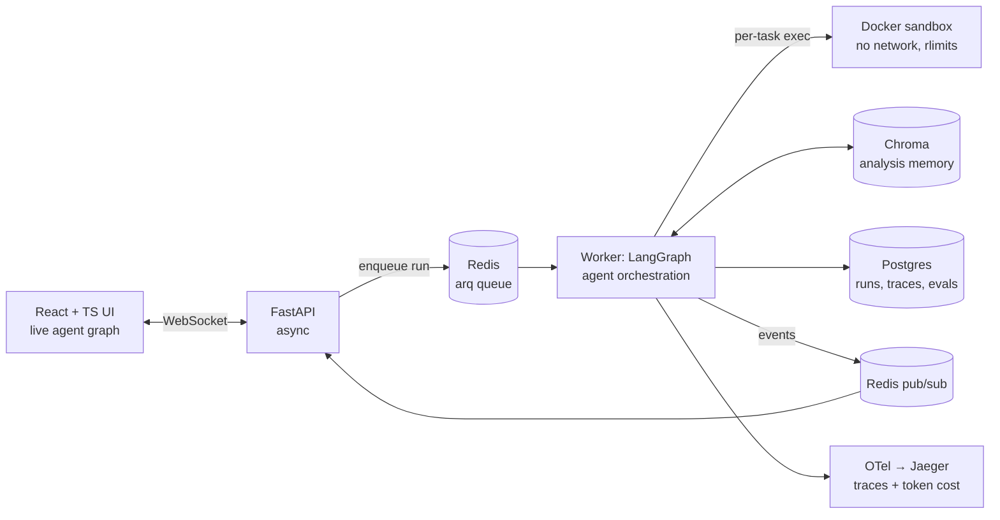
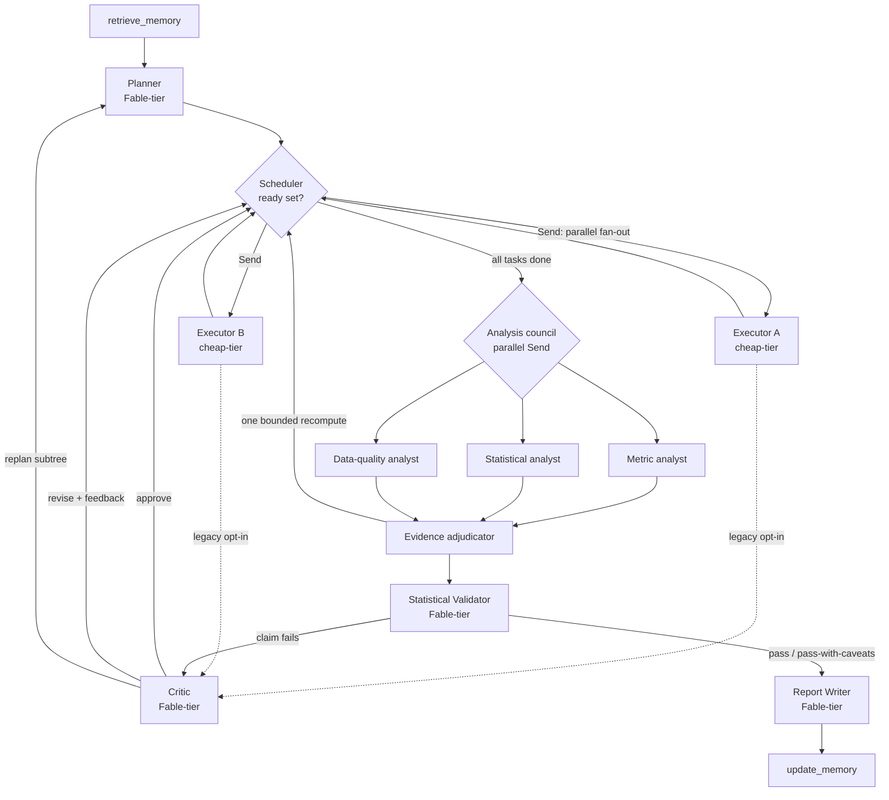

# Architecture Proposal — Multi-Agent Autonomous Data Analyst

**Status:** Implemented and evaluated (v1.0). The final product defaults follow the
completed ablation scorecard; historical design alternatives remain documented.

---

## 0. Constraints that shape everything

1. **Zero API budget.** You asked for free. This is achievable without gutting the project, and the mechanism is itself interview-worthy (§6). Three LLM backends behind one interface:
   - **`local`** — Ollama running open models on your machine (e.g., Qwen2.5-Coder 7B for codegen, a larger model for reasoning if your hardware allows). Unambiguously free. Primary dev/demo path.
   - **`replay`** — recorded prompt→response cassettes. Makes CI and eval re-runs $0, fast, and deterministic. This is how real teams keep LLM test suites affordable.
   - **`anthropic`** — the config exists and is wired (Fable 5 / Opus 4.8 / Haiku 4.5 model strings), so if you ever get credits (many providers offer student/free credits — verify current programs) you flip one env var and record fresh cassettes. Note: hosted free tiers (Google AI Studio, Groq) can slot into the same `openai-compatible` client if their current limits allow; verify before relying on them.
2. **Benchmark domain: manufacturing/operations** (your IE background). We generate the synthetic data ourselves, which means we control ground truth and can plant traps deliberately (§7).
3. **Portfolio, single user, runs locally.** This drives the sandbox decision (§4) and the over-engineering audit (§8).

---

## 1. System overview



**Why a queue at all:** an agent run takes minutes. Holding an HTTP request open that long is fragile (timeouts, dropped connections, no retry). The API enqueues a job and returns a `run_id` immediately; the worker executes the graph; progress streams to the UI over WebSocket via Redis pub/sub. `arq` over Celery: async-native (matches FastAPI + LangGraph), ~1 file of config vs Celery's machinery we don't need.

**Two databases, deliberately:** Postgres is the system of record (every run, every agent step, every verdict, eval results — relational, queryable, auditable). Chroma stores only embeddings + pointers back to Postgres rows. Vector DBs are bad systems of record; this separation is a talking point, not an accident.

---

## 2. The agent graph — the core design decision

### 2.1 Two levels: static control loop, dynamic task DAG

The most important architectural insight, and the thing to lead with in interviews:

**A LangGraph graph is compiled ahead of time — but the planner invents a different task DAG for every question. You cannot make the analysis DAG *be* the LangGraph graph.**

So there are two levels:

- **Outer (static): the control loop.** A fixed LangGraph `StateGraph` — plan,
  dispatch, execute, critique, council, adjudicate, validate, finalize. Same shape
  for every question. This is where streaming and retry policy live.
- **Inner (dynamic): the analysis DAG.** The planner's output is *data* in the graph state: a set of `TaskSpec` nodes with `depends_on` edges. A **scheduler node** in the outer loop computes the ready set (tasks whose dependencies are all `done`) each cycle and fans them out to executor instances concurrently using LangGraph's `Send` API. Independent branches genuinely run in parallel.



### 2.2 State: one typed object, reducer-merged

All agents read/write a single Pydantic-typed `AnalysisState`. LangGraph persists it at every node boundary (checkpointing → resumable runs, and the UI replays it).

```python
class TaskSpec(BaseModel):
    id: str
    goal: str                    # natural-language sub-task
    depends_on: list[str]
    kind: Literal["sql", "python", "reuse"]   # "reuse" = memory hit
    status: Literal["pending", "running", "done", "rejected"]
    attempts: int = 0

class AnalysisState(BaseModel):
    run_id: str
    question: str
    dataset: DatasetManifest          # schemas, content_hash, typed EDA/quality report
    dag: dict[str, TaskSpec]
    artifacts: dict[str, Artifact]    # per task: code, stdout, result table, error
    verdicts: dict[str, CriticVerdict]
    council_findings: dict[str, CouncilFinding]
    council_decisions: list[CouncilDecision]
    claims: list[ValidatedClaim]      # validator output, incl. caveats
    predictive_evidence: dict[str, PredictiveEvidence]
    memory_hits: list[MemoryHit]
    report: Report | None
    budgets: Budgets                  # replans_left, per-task retries, step cap
```

Parallel executors write to **disjoint keys** of `artifacts` (their own `task_id`), merged with a dict-union reducer — no lock, no race, and a clean answer to "how do concurrent agents avoid clobbering state?"

### 2.3 The legacy critic loop — retained for ablations

The critic is **adversarial, not a rubber stamp**: it receives the sub-task goal, the generated code, the result, and the dataset schema, and is prompted to actively hunt for a specific checklist of failure classes (join fan-out/duplication, survivorship bias, silent null handling, aggregation over mixed grains, cherry-picked windows, correlation-as-causation). The completed ablation showed that it does not earn default status, but the implementation remains available behind `--critic` for reproducibility. It returns a structured verdict:

| Verdict | Meaning | What happens |
|---|---|---|
| `approve` | No material flaw | Task marked `done`; downstream tasks unblock |
| `revise(feedback)` | Code/approach flaw, goal is fine | Task back to `pending` with critic feedback injected into the executor prompt; `attempts += 1` |
| `replan(reason)` | The *sub-task itself* is wrong (e.g., the decomposition baked in the bias) | That task + its downstream subtree invalidated; planner re-plans the subtree with the reason attached |

**Termination guarantees** (interviewers always ask): per-task retry budget (2 revisions), per-run replan budget (2), and a global step cap. When a budget is exhausted the task completes as `done-with-unresolved-objection` — the objection is not dropped; it flows into the report's caveats section. The system degrades to honesty, not to silence.

Every verdict is written to Postgres (the rejection ledger) — this is the raw material for the with/without-critic eval.

### 2.4 The analysis council — independent evidence, explicit disagreement

After all task artifacts settle, the scheduler fans the same immutable evidence
packet to three real parallel LangGraph branches:

- **Metric analyst:** does the result answer the business question with the right
  metric, denominator, and interpretation?
- **Statistical analyst:** are uncertainty, confounding, multiple comparisons, and
  effect size handled?
- **Data-quality analyst:** are joins, grain, duplicates, missingness, coverage, and
  survivorship handled?

Each returns a structured `CouncilFinding`: verdict, conclusion, canonical
`answer_key`, evidence task ids, risks, confidence, and an optional recomputation
request. Specialists cannot see one another's output. If all three support the same
answer key, the graph records deterministic consensus and spends no adjudicator
tokens. Otherwise an evidence adjudicator sees the artifacts plus all findings and
either accepts a conclusion with named dissent or sends one existing task back with
a concrete instruction. `council_recomputes_left=1` prevents debate loops; a second
unresolved request becomes a visible caveat.

Before spending those calls, `assess_council_risk` scores broad, deterministic
signals from the question, task goals, critic verdicts, and executed code:
statistical/temporal language, group-composition comparisons, joined rates,
multi-table execution, and prior rejection. The decision (`mode`, score, threshold,
reasons, invoked) is persisted and shown in the UI. The live evaluation showed that
`adaptive` did not save cost or accuracy, so `off` is the Standard default and
`always` is the explicit High-assurance mode. `adaptive` remains experimental.

The completed deletion test selected `council-no-critic`: it scores 0.86 versus
0.56 for the bare baseline and is perfect on benchmark tiers 1–3. The standard
validator-only path scores 0.80 with 3,429 mean tokens; the high-assurance council
gains six points at 17,223 mean tokens, so the modes expose that tradeoff directly.

### 2.5 Automatic EDA and data-quality profiling

`build_manifest` profiles every loaded CSV before planning, using deterministic
pandas rules rather than another model call. The typed report contains table shape,
duplicate rows, candidate and invalid keys, column missingness/cardinality, numeric
distributions and IQR outliers, categorical frequencies, datetime ranges, label and
mixed-type inconsistencies, plus inferred `*_id` relationships and orphan counts.
The report and its transparent readiness score are embedded in `DatasetManifest`.

This placement makes quality evidence available everywhere without a second data
scan: the planner and data-quality specialist see a compact risk summary in the
schema, while the API persists and streams the full report to expandable React
cards. Rules recommend remediation but do not mutate data. Ambiguous relationships
are skipped rather than guessed. Exact rules, scoring, and scaling/privacy
boundaries are in `docs/DATA_QUALITY.md`.

### 2.6 The statistical validator — checks, not vibes

Separate from the critic and council on purpose: the critic reviews task method, the
council compares independent interpretations, and the validator gates report-bound
quantitative claims. It checks sample size, uncertainty, multiple comparisons,
confounding, denominators, and overprecision. Before the LLM verdict, a deterministic
SciPy layer validates executor-supplied sufficient statistics and computes Wilson,
Newcombe-Wilson, Student/Welch intervals; exact binomial, proportion, Welch, and
chi-square tests; and scale-appropriate effect sizes. The typed evidence is persisted,
streamed to the UI, and included in the final report. Output per claim remains
`pass`, `caveat`, or `fail`; a fail sends the source task back for recomputation while
budget remains. Confounding/mix failures deterministically add a
`stratified_proportion` contract to that retry: the executor emits a complete
group-by-stratum sufficient-statistics grid, and the engine performs direct
standardization, overlap checks, pairwise Simpson-reversal detection, and (for two
groups) Mantel-Haenszel inference. Power, multiplicity correction, continuous-
confounder regression, and causal identification remain separate future increments.

### 2.7 Governed predictive modeling

For prediction questions, the executor emits a typed `modeling_requests`
specification rather than fitting a model and self-reporting its training score. A
trusted scikit-learn layer loads only manifest tables, permits only validated
one-to-one/many-to-one joins, and rejects target/identifier leakage, row-increasing
joins, missing split columns, unknown features, and oversized local workloads.

Random, temporal, and entity-group holdouts are first-class policies. Model choice
(logistic/ridge versus random forest) occurs through cross-validation entirely
inside the training partition; the holdout is evaluated once. Evidence includes
dummy-baseline comparisons, classification or regression metrics, a deterministic
bootstrap interval on the primary holdout metric, train/holdout gap diagnostics,
model-agnostic permutation importance, and optional subgroup slices. The statistical
validator then audits semantic feature timing and whether the split matches intended
deployment. Typed evidence follows the same persistence/WebSocket/final-report path
as deterministic inference. Full contracts and limitations are in
`docs/PREDICTIVE_MODELING.md`.

### 2.8 Memory — query at plan time, write only validated results

- **Embeddings:** local `sentence-transformers` (MiniLM) — free, no API dependency.
- **Two Chroma collections:** `runs` (whole-question level) and `subresults` (validated sub-task level, the reuse unit).
- **Query (plan time):** embed the question + schema fingerprint → top-k over `subresults`, filtered by `dataset_content_hash` (a cached result from *stale data* is worse than recomputing — the hash filter is the staleness guard). Hits above a similarity threshold are offered to the planner, which may emit `kind="reuse"` nodes instead of recompute nodes.
- **Write (run end):** only claims that passed the validator are embedded and stored, with metadata pointing at the Postgres run/step rows. Rejected work is never stored as reusable truth. (Stretch: store critic findings as "known pitfalls for this dataset," retrieved at critique time.)
- **Provenance:** reused results are cited in the report as reused-from-run-X, validated-on-date-Y.

---

## 3. Model routing

A YAML config maps role → provider/model — swappable per environment, and the eval harness treats the routing table as an experimental variable:

```yaml
routing:
  planner:    {tier: reasoning}
  critic:     {tier: reasoning}
  validator:  {tier: reasoning}
  council_statistical: {tier: reasoning}
  council_data_quality: {tier: reasoning}
  adjudicator: {tier: reasoning}
  reporter:   {tier: reasoning}
  executor:   {tier: mechanical}
  summarizer: {tier: mechanical}
tiers:
  reasoning:  {anthropic: claude-fable-5,   local: qwen2.5:14b-instruct}
  mechanical: {anthropic: claude-haiku-4-5, local: qwen2.5-coder:7b}
```

**One honest pushback on your spec:** Opus 4.8 as the *cheap* tier undercuts the routing story — Opus is a premium model, so the cost gap vs Fable 5 is modest and the "routing saves money" claim gets weak. The compelling version is a wide gap: **Fable 5 for reasoning (planner, critic, validator, reporter), Haiku 4.5 (or Sonnet 5) for mechanical steps (codegen against a well-specified sub-task, summarization).** Same architecture, much stronger eval result. The config keeps Opus available as a middle tier if you want a 3-way comparison. Locally, the analog is 14B-class vs 7B-class models — the routing *mechanism* is what you're demonstrating; cassettes recorded from any tier pair prove it works.

---

## 4. Sandbox design — the security component

**Threat model:** we execute LLM-generated Python against user data. Realistic risks, in order: (1) resource exhaustion (infinite loop, memory bomb — *will* happen by accident), (2) data exfiltration (code phones home), (3) filesystem damage outside the workspace, (4) prompt-injected data poisoning the generated code (a CSV cell containing instructions). Host-kernel escape by a hostile tenant is *not* in our threat model — single user, own machine.

**Decision: one Docker container per execution**, from a prebuilt `analyst-sandbox` image (pandas, numpy, scipy, statsmodels, duckdb, matplotlib preinstalled — so per-run startup is container start ~100–300 ms, not pip install):

| Control | Flag / mechanism | Kills which threat |
|---|---|---|
| No network | `--network none` | Exfiltration, phoning home |
| Read-only rootfs + tmpfs `/tmp` | `--read-only --tmpfs /tmp` | FS damage, persistence |
| Dataset mounted read-only | `-v data:/data:ro` | Source data mutation |
| CPU / memory / process caps | `--cpus 1 --memory 1g --pids-limit 128` | Resource exhaustion, fork bombs |
| Non-root, no capabilities | `--user nobody --cap-drop ALL --security-opt no-new-privileges` | Privilege escalation |
| Hard wall-clock timeout | Runner kills container at 60 s | Infinite loops |
| Output contract | Result must be `result.json` (schema-validated); stdout truncated | Log flooding, malformed handoff |

**SQL without exposing the app DB:** generated SQL runs via **DuckDB inside the sandbox** over the dataset files. Generated code can never see the application's Postgres — real SQL capability, zero blast radius. Clean interview line: *"the LLM's code and my system's database are never on the same side of the wall."*

**Failure taxonomy → routing:** timeout / OOM / nonzero exit / contract violation are distinct outcomes recorded on the artifact. Deterministic failures retry to the executor with the error attached (that's a bug loop, not a critique); only *clean* results reach the critic.

**Why not Firecracker/gVisor/E2B:** microVMs buy hardened multi-tenant kernel isolation — the right call for a SaaS running strangers' code, overkill for a single-user local tool, and non-portable (Firecracker needs bare-metal KVM). The honest, defensible upgrade path, documented in the README: same-machine hardening → swap Docker's runtime for gVisor (`--runtime=runsc`, one flag, same images); hosted multi-tenant → E2B (Firecracker-based, has a free tier) behind the same `SandboxRunner` interface. The interface is the architecture; the backend is a deployment decision.

---

## 5. Backend, frontend, observability

- **FastAPI (async):** `POST /runs` → enqueue, return `run_id` · `GET /runs/{id}` → state from Postgres · `WS /runs/{id}/stream` → live events. The API process never runs agent graphs.
- **Event flow:** worker publishes structured events (`node_started`, `token_delta`, `verdict`, `task_state_changed`) to Redis pub/sub → FastAPI fans out to WebSocket clients. UI can also rebuild current state from checkpoints on reconnect — streaming is UX, Postgres is truth.
- **React + TypeScript UI:** live DAG view (React Flow — nodes colored by status, critic rejections visibly snapping tasks back), a per-agent reasoning stream pane, and a run history page. Vite + React Query + native WebSocket; no Redux (over-engineering at this scale).
- **Observability: OpenTelemetry + Jaeger** (both free/self-hosted; LangSmith is a paid SaaS — wrong fit for a $0 constraint, and OTel is the vendor-neutral skill). One span per agent node, child spans per LLM call and sandbox execution, attributes for tokens in/out and computed cost. The demo moment: a Jaeger flame graph of a run showing parallel executor branches and exactly where time and tokens went.

---

## 6. Zero-cost LLM strategy (recap, since it's load-bearing)

`LLMClient` protocol; three implementations selected by env config: `anthropic`, `openai-compatible` (Ollama local; also fits hosted free tiers if current limits allow), `replay`. Every live call is recorded as a cassette keyed on `(role, prompt_hash)`. Consequences: **CI is $0 and deterministic** (replay only), eval re-runs are free, and the Anthropic routing table ships wired-but-dormant. One more avenue worth checking: the Claude Agent SDK has supported authenticating via a Claude subscription (which you have, via this app) rather than a metered API key — if that holds currently, it's a genuinely free path to frontier-model cassettes; verify terms before building on it.

---

## 7. Evaluation harness — the differentiator

**Benchmark: 25 questions over a synthetic manufacturing dataset** (machines, work orders, shifts, operators, downtime events, defects, suppliers, decommissioned equipment) generated by *our* script — so ground truth is exact and traps are planted, not hoped for:

| Tier | n | Example | Tests |
|---|---|---|---|
| 1 — Lookup | 6 | "Which machine had the most downtime hours in Q1?" | Basic correctness, cheap-tier codegen |
| 2 — Multi-table | 7 | "Defect rate by supplier, weighted by lot size" | Joins, grain handling, DAG parallelism |
| 3 — Statistical | 7 | "Did the new maintenance schedule reduce downtime?" | Validator: CIs, sample size, confounders |
| 4 — Adversarial | 5 | "Which shift has the best quality record?" (planted: night shift only runs easy jobs — job-mix confounder) | Does the system flag, or answer confidently wrong? |

Planted traps include a job-mix confounder across shifts, survivorship bias via decommissioned machines missing from current-state tables, a join that fans out (duplicate work-order rows), and a Simpson's-paradox supplier comparison.

**Scoring:**

1. **Correctness** — executable checkers against known ground truth (numeric tolerance), not string matching and not LLM-judged.
2. **Trap handling** — on tier-4, scored on whether the caveat/uncertainty was surfaced; a confident wrong answer scores worse than "flagged and hedged."
3. **Critic catch rate via fault injection** — mutation testing for agents: deliberately corrupt executor outputs (drop a dedup, swap weighted→unweighted mean) in N runs and measure the critic's detection rate. This isolates the critic's value independent of end-to-end accuracy.
4. **Latency and tokens/cost** per run, per agent, from OTel spans.

**Ablations (the headline result):** seven complete, zero-error configurations under
the same benchmark, model routing, and scoring. `council-no-critic` leads at 0.86;
the standard `no-critic` path scores 0.80 efficiently; `bare` scores 0.56. Removing
the validator costs 12 points. The critic adds no overall score, and adaptive routing
also fails to improve accuracy or cost, so neither remains a product default.

**Held-out statistical suite:** the original manufacturing questions remain frozen
as the ablation receipt. A separate `heldout-statistical-v1` generator creates six
product-analytics/support tables per seed and evaluates 20 new questions: five each
for estimation, tests/effect sizes, confounding, and design/data-quality reasoning.
Two composition reversals are balanced by a no-reversal stratified sound control.
Each question has an explicit three-to-five-component rubric derived from the CSV
bytes; numeric scoring reads semantically relevant typed evidence fields rather than
all arbitrary artifact numbers.

The held-out integrity key is `(suite version, config, seed, dataset content hash)`.
Only exact 20-item, zero-error runs enter its separate scorecard. Multiple valid
seeds aggregate without replacing one another, and a 95% t-interval over seed-level
means is shown only for two or more seeds. This score is deliberately kept separate
because its component rubric is not comparable to the original trap scoring.

**CI (GitHub Actions, $0):** every push → lint, unit tests, sandbox contract tests, and the eval suite in **replay mode** (deterministic, no API calls, minutes not hours). Live-model eval is a manual `workflow_dispatch` job for when a key/credits exist.

---

## 8. Over-engineering audit

| Component | Verdict | Reasoning |
|---|---|---|
| Sandbox isolation | **Necessary** | Executing generated code without it is negligent, not lean |
| Task queue (arq) | **Necessary** | Multi-minute runs can't live inside HTTP requests |
| Dynamic-DAG-in-state | **Necessary** | The alternative (linear chain) is exactly what you asked to avoid |
| Eval harness + ablations | **Necessary** | It's the thesis of the project |
| Separate held-out statistical suite | **Necessary for generalization claims** | New domain/schema, seed-level replication, sound controls, and a separate integrity gate reduce development-benchmark overfitting |
| Postgres trace store | **Necessary** | Debugging agents without traces is guesswork |
| Chroma (vs pgvector) | **Justified for learning** | pgvector = one fewer service and would be my pick in production at this scale; Chroma chosen because vector-DB experience is an explicit goal. Say exactly this in interviews. |
| OTel + Jaeger (vs structured logs) | **Justified for learning** | Logs would suffice at this scale; distributed tracing is the transferable skill |
| Statistical validator | **Necessary — eval-tested** | Removing it costs 12 overall points and eliminates trap flagging |
| Adversarial critic | **Not justified as default** | No overall gain, 2.36× standard-path tokens, and 50% false-positive rate on sound controls; retained only for ablations |
| Three-specialist council | **Justified as High assurance** | `council-no-critic` is the best configuration at 0.86, but its 5× token cost versus Standard makes it opt-in |
| Adaptive council router | **Not justified as default** | Live evaluation matched Standard accuracy while consuming 19,892 vs 3,429 mean tokens |
| Firecracker/microVMs | **Over-engineering — not building** | Documented upgrade path instead (§4) |
| Kubernetes manifests | **Over-engineering — not building** | Compose file written 12-factor style (config via env, stateless API/worker, healthchecks) so the k8s story is "Deployments + Services + a StatefulSet for Postgres," told in the README |
| Auth / multi-tenancy | **Out of scope** | Single-user portfolio system; noted as production delta |
| LLM-based dynamic router | **Over-engineering** | Static role→tier config is explainable and testable; "a router model choosing models" is complexity with no eval to justify it |

---

## 9. Build phases

Each phase ends with something runnable + a short "what I learned" note (these become the README's build log).

| Phase | Scope | New tech introduced | Done when |
|---|---|---|---|
| a | Planner + executor, CLI entry, LangGraph loop, DAG-in-state, sandbox v1 (full flags from day one) | LangGraph, Docker sandbox | Tier-1/2 questions answered end-to-end from CLI |
| b | Critic + revise/replan loop, budgets, rejection ledger | — | Fault-injected run visibly caught and corrected |
| c | Statistical validator, claim extraction, caveat propagation | — | Tier-3 question ships with a correct caveat |
| d | Chroma memory, local embeddings, reuse nodes, staleness hash | Vector DB | Repeat question reuses a validated sub-result |
| e | FastAPI + arq + Redis events + React DAG UI | FastAPI, arq, React/TS, WebSockets | Live run visible in browser, rejections animate |
| f | Benchmark, fault injector, ablation runner, scorecard | Eval engineering | With/without-critic scorecard generated |
| g | Docker Compose for all services; OTel + Jaeger | Compose, OTel | `docker compose up` → working system + traces |
| h | GitHub Actions: lint + tests + replay-mode eval | CI | Green pipeline on push, $0 |

Ordering rationale: sandbox is in phase (a) because it's a core component, not a hardening afterthought; the eval harness (f) lands before containerization (g) so the ablation numbers exist before we polish packaging.

---

## 10. Repo shape (target)

```
analyst/
  agents/          # planner, executor, critic, council/adjudicator, validator
  graph/           # LangGraph control loop, state models, scheduler, reducers
  sandbox/         # SandboxRunner interface + docker backend + result contract
  llm/             # LLMClient protocol: anthropic / openai_compatible / replay + cassettes
  memory/          # chroma client, embedding, staleness
  api/             # FastAPI app, websocket, arq worker entry
  eval/            # benchmark questions, data generator, fault injector, scorecard
frontend/          # React + TS (Vite)
docker/            # sandbox image, compose file
docs/              # this file, README, build log
.github/workflows/
```
