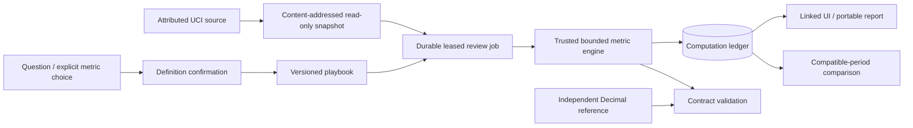

# Case study: auditable weekly retail reviews

## Problem and resulting workflow

A request such as “what happened to revenue?” leaves sales definitions,
cancellations, line grain, and missing records unspecified. A useful review needs
explicit business semantics and an inspectable calculation behind its conclusions.

The operations workspace freezes a CSV snapshot, runs a saved playbook of metric
contracts, stores aggregate computations in an evidence ledger, and compares the
next compatible period. Optional local language interpretation proposes only
typed requests; calculations remain owned by trusted DuckDB queries.

## Data and observed results

Source: Chen, D. (2015), [Online Retail, UCI](https://doi.org/10.24432/C5BW33), CC BY 4.0.
The archive, workbook, conversion, and four weekly slices are hash-pinned in
`data/retail/SOURCE.json`. The full conversion retains all 541,909 source rows.
Prices, identifiers, missing cells, cancellation flags, and duplicates have
explicit handling; source files are not silently corrected.

The first two complete seven-day slices produced these all-country results:

| Metric | Nov 1–7, 2011 | Nov 8–14, 2011 |
|---|---:|---:|
| Gross sales under the contract | £330,410.49 | £398,583.05 |
| Cancellation value | £20,618.09 | £9,882.88 |
| Net sales under the contract | £309,792.40 | £388,700.17 |
| Distinct eligible positive invoices | 554 | 655 |
| Known active customer IDs | 452 | 526 |
| Cancellation-invoice fraction | 100 / 654 | 123 / 778 |

Net sales increased by £78,907.77 in these recorded periods. The cancellation
invoice fraction increased while cancellation value fell: a count-based fraction
and an amount-weighted metric answer different questions. The output makes both
definitions visible. These are descriptive historical records under the project's
contract, not audited financial statements or evidence of causal drivers.

See the [first report](../retail_results/development.html),
[refresh report](../retail_results/refresh.html), and
[complete comparison](../retail_results/comparison.json). Each displayed metric
links to its query, transformation, parameters, numerator/denominator, source-row
counts, and data/definition fingerprints.

## Validation and engineering evidence

- The frozen real-data suite contains 100 questions and 20 two-turn scenarios.
  All **140 metric/oracle and definition-guard checks pass**. This measures the
  deterministic tool contracts and explicit guards, not model-language accuracy.
- Independent row-wise Python/Decimal logic supplies reference calculations.
- Tests cover duplicates, missing IDs, cancellation/sign rules, fractional units,
  price precision, empty periods, incompatible definitions, snapshot corruption,
  idempotency, cancellation/retry, lease recovery, concurrent completion, query
  interruption, export escaping, and exact currency display.
- Resource-tracked runs cover weekly slices and the entire 541,909-row conversion.
  Exact observed timings and process-lifetime peak RSS are in
  [runtime.json](../retail_results/runtime.json). They are sequential local runs;
  the 256 MB DuckDB setting does not cap Python/library/process overhead.
- Historical agent scorecards independently reproduce from their cited inputs.
  Their 0.86/0.56 result is separate from the new operations suite.

## Remaining evidence

The user deferred live local-agent evaluation and actual participants. The
resumable live harness and counterbalanced pilot are prepared; **no model score,
time saving, adoption count, or enterprise deployment is claimed** for this work.
The project remains a single trusted local workspace. A public arbitrary-code
service would require a different isolation/access/resource design.

For AI/ML roles, the contribution is governed tool use, evaluated policy boundaries,
durable execution, and inspectable outputs. For analytics roles, it is explicit
metric semantics, real-data correctness checks, caveat-preserving interpretation,
and a repeatable workflow whose usefulness can be measured in the prepared pilot.
